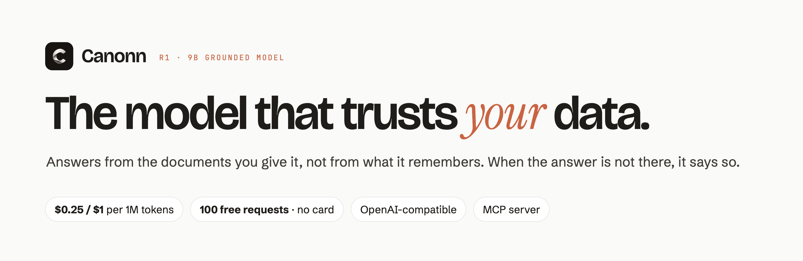

<picture>
  <source media="(prefers-color-scheme: dark)" srcset="assets/gh-banner-dark.png">
  
</picture>

Canonn builds models that answer from your data. **Canonn R1** is a 9B model trained to follow the documents you give it instead of what it remembers, to say so when the answer is not there, and to flag documents that disagree.

| | |
|---|---|
| **Start building** | [Canonn-ai/canonn](https://github.com/Canonn-ai/canonn): quickstarts, OpenAPI spec, a payables agent example |
| **API** | OpenAI-compatible at `https://api.canonn.ai/v1` · $0.25 / $1 per 1M tokens · 100 free requests |
| **Proof** | [canonn.ai/benchmark](https://canonn.ai/benchmark/): every number with its method |
| **Agents** | MCP server for Claude Code, Codex and OpenCode: [canonn.ai/mcp](https://canonn.ai/mcp/) |

[canonn.ai](https://canonn.ai) · [Docs](https://canonn.ai/docs/) · [Get an API key](https://canonn.ai/dashboard/) · hello@canonn.ai
